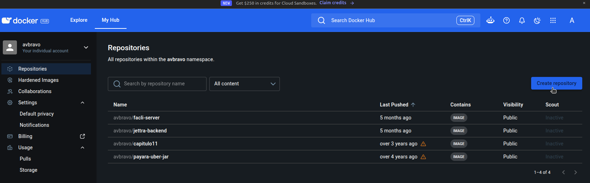
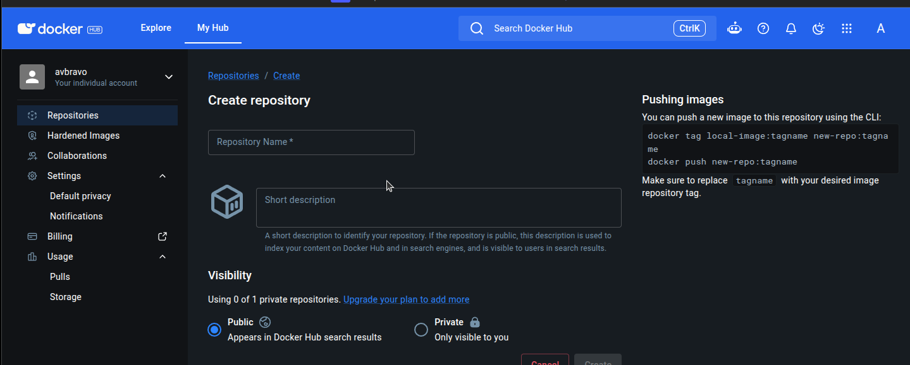
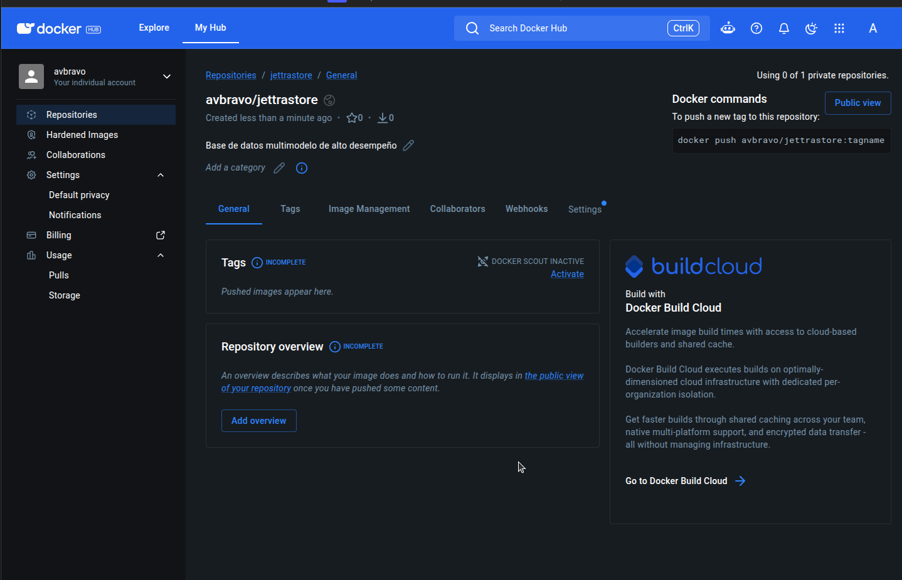
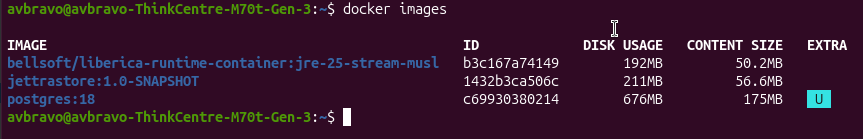
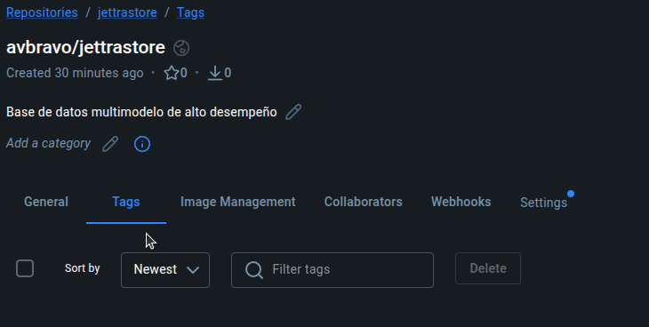
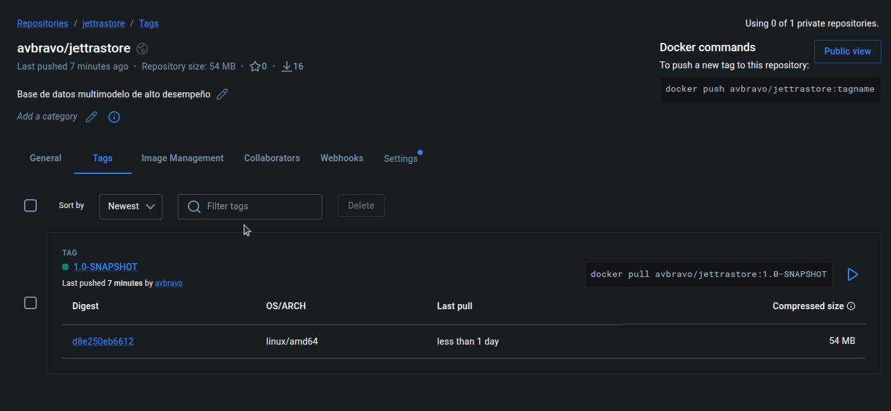
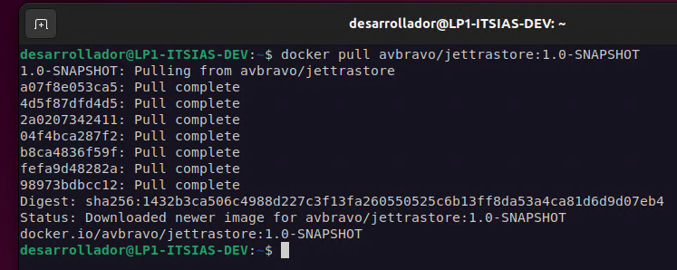

# DOCKER HUB

Ingresar a https://hub.docker.com/repositories/avbravo

1. Dar clic en el boton Create Repository




2. Indicar los datos del repositorio y la descripcion



Datos generales




3. Verificar

Docker commands
To push a new tag to this repository
```
docker push avbravo/jettrastore:tagname
```


## Generar la imagen de Docker

A partir del archivo Docker file

```
# ==============================================================================
# JettraStore Distributed Multi-Model Database (Java 25+ Panama FFM & Raft)
# Multi-stage Alpaquita/musl build optimizado para bajo consumo de RAM y CPU
# ==============================================================================
FROM bellsoft/liberica-runtime-container:jre-25-stream-musl AS packager
WORKDIR /staging
COPY target/JettraStore-*.jar /staging/
COPY src/main/resources/META-INF/microprofile-config.properties /staging/config/microprofile-config.properties
COPY src/main/resources/cluster.config /staging/config/cluster.config
RUN rm -f /staging/original-JettraStore-*.jar && \
    if [ -f /staging/JettraStore-*-uber.jar ]; then \
        mv /staging/JettraStore-*-uber.jar /staging/JettraStore.jar && rm -f /staging/JettraStore-*.jar; \
    elif [ -f /staging/JettraStore-*.jar ]; then \
        mv /staging/JettraStore-*.jar /staging/JettraStore.jar; \
    fi && \
    cp /staging/config/cluster.config /staging/config/jettra.config

FROM bellsoft/liberica-runtime-container:jre-25-stream-musl
LABEL maintainer="Jettra Ecosystem <dev@jettra.io>"
LABEL description="JettraStore - Motor de Base de Datos Multimodelo Distribuido en Java 25+ (Bajo Consumo RAM/CPU)"

RUN if command -v apk > /dev/null; then \
        apk add --no-cache curl ca-certificates tzdata && rm -rf /var/cache/apk/* /tmp/*; \
    elif command -v apt-get > /dev/null; then \
        apt-get update && apt-get install -y --no-install-recommends curl ca-certificates tzdata && rm -rf /var/lib/apt/lists/* /tmp/*; \
    fi

WORKDIR /app

RUN mkdir -p /jettra/data /jettra/config /jettra/checkpoint /app/config && \
    chown -R 1000:1000 /jettra /app

COPY --from=packager --chown=1000:1000 /staging/JettraStore.jar /app/JettraStore.jar
COPY --from=packager --chown=1000:1000 /staging/config/ /app/config/

# Flags Java 25+ optimizados para bajo footprint de RAM/CPU en contenedores
ENV JETTRA_NODE_ID=node-01 \
    JETTRA_NODE_ROLE=PRIMARY \
    JETTRA_NODE_IP=0.0.0.0 \
    JETTRA_STORAGE_PATH=/jettra/data \
    JETTRA_STORAGE_MODE=OFF_HEAP \
    JETTRA_MULTINODE_ACTIVE=on \
    JETTRA_CRAC_CHECKPOINT_PATH=/jettra/checkpoint \
    JETTRA_CRAC_RESTORE=false \
    JETTRA_GRPC_PORT=50001 \
    JETTRA_REST_PORT=60001 \
    JETTRA_ADMIN_USERNAME=admin \
    JETTRA_ADMIN_PASSWORD=admin-jettra \
    JETTRA_SAMPLES_AUTOLOAD=false \
    JAVA_TOOL_OPTIONS="-XX:+UseContainerSupport -XX:+UseG1GC -XX:+UseStringDeduplication -XX:CICompilerCount=2 -XX:+UnlockExperimentalVMOptions -XX:+UseCompactObjectHeaders -XX:MaxRAMPercentage=70.0 --enable-preview --enable-native-access=ALL-UNNAMED" \
    JAVA_OPTS="-Xms96m -Xmx384m -XX:MaxMetaspaceSize=192m -XX:MaxDirectMemorySize=192m"

EXPOSE 60001 50001

VOLUME ["/jettra/data", "/jettra/checkpoint"]

HEALTHCHECK --interval=10s --timeout=5s --start-period=8s --retries=3 \
    CMD curl -fsS http://localhost:${JETTRA_REST_PORT}/api/v1/health || exit 1

USER 1000:1000

ENTRYPOINT ["sh", "-c", "if [ \"$JETTRA_CRAC_RESTORE\" = \"true\" ] && [ -d \"$JETTRA_CRAC_CHECKPOINT_PATH\" ] && [ \"$(ls -A $JETTRA_CRAC_CHECKPOINT_PATH 2>/dev/null)\" ]; then \
        echo '[CRaC] Restaurando JettraStore desde checkpoint CRIU en '$JETTRA_CRAC_CHECKPOINT_PATH'...'; \
        exec java -XX:CRaCRestoreFrom=$JETTRA_CRAC_CHECKPOINT_PATH; \
    else \
        exec java $JAVA_OPTS \
            -Djettra.storage.path=${JETTRA_STORAGE_PATH:-/jettra/data} \
            -Djettra.storage.mode=${JETTRA_STORAGE_MODE:-OFF_HEAP} \
            -Dcluster.multinode.active=${JETTRA_MULTINODE_ACTIVE:-on} \
            -Djettra.samples.autoload=${JETTRA_SAMPLES_AUTOLOAD:-false} \
            -Dmicroprofile.config.file=/app/config/microprofile-config.properties \
            -Dcluster.config.path=${JETTRA_CLUSTER_CONFIG_PATH:-/app/config/cluster.config} \
            -jar /app/JettraStore.jar; \
    fi"]
```


## Crear la imagen en el directorio actual

Se utiliza el comando build con algunos parámetros:

-t  :Nombre del tag para la imagen a crear.

.   :Al final le indica a docker que busque el archivo Dockerfile en el directorio actual


```shell
docker build -t jettrastore:1.0-SNAPSHOT .

```
o para indicar la última versión

```shell
docker build -t jettrastore:latest .
```

* Consultar imagenes

docker images





## Consola Docker local


A continuación, ejecute el siguiente comando, asegurándose de reemplazar 'username' con su nombre de usuario en Dockerhub:

```shell
docker login -u <username> 
```

Después de presionar enter, se solicita que ingrese su contraseña.

Para cargar la imagen al repositorio, ejecute el comando push especificando el nombre de usuario y el nombre de la imagen.

Ver las imágenes

```shell
docker images
```


## Subir la imagen  a Docker Hub

Regresamos a DockerHub y vemos la imagen

Desde Interface Web dar clic en Tags 


Crear un tag para esa versiòn:

```shell
# Ejemplo si existe como jettrastore:1.0-SNAPSHOT
docker tag jettrastore:1.0-SNAPSHOT avbravo/jettrastore:1.0-SNAPSHOT

# O si existe como avbravo/jettrastore:latest
docker tag avbravo/jettrastore:latest avbravo/jettrastore:1.0-SNAPSHOT
```


# Subir la imagen

```shell
    docker push avbravo/jettrastore:1.0-SNAPSHOT
```



Se observar

```shell
docker pull avbravo/jettrastore:1.0-SNAPSHOT
```




Ejecute el contenedor

docker run -d -p 50001:50001 --name jettrastore avbravo/jettrastore:1.0-SNAPSHOT 

o

docker run -d -p 1.0-SNAPSHOT --name jettrastore avbravo/jettrastore:latest


## Variables de entorno

Pasando variables de entorno

Si ha configurado variables de entorno por ejemplo MY_PATH, esta variable también se puede pasar mediante el atributo -e


docker run -it --rm \
  -p 50001:50001 \
  -v jettra_db_volume:/app/db \
  jettrastore -console -e MY_PATH=\home\avbravo\Descargas


## Crear volumen

Si necesita crear un volumen ejecute

```shell
docker volume create jettradata
```
